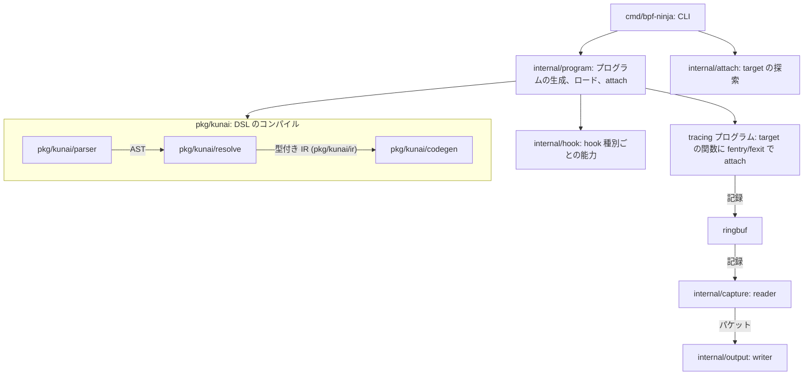
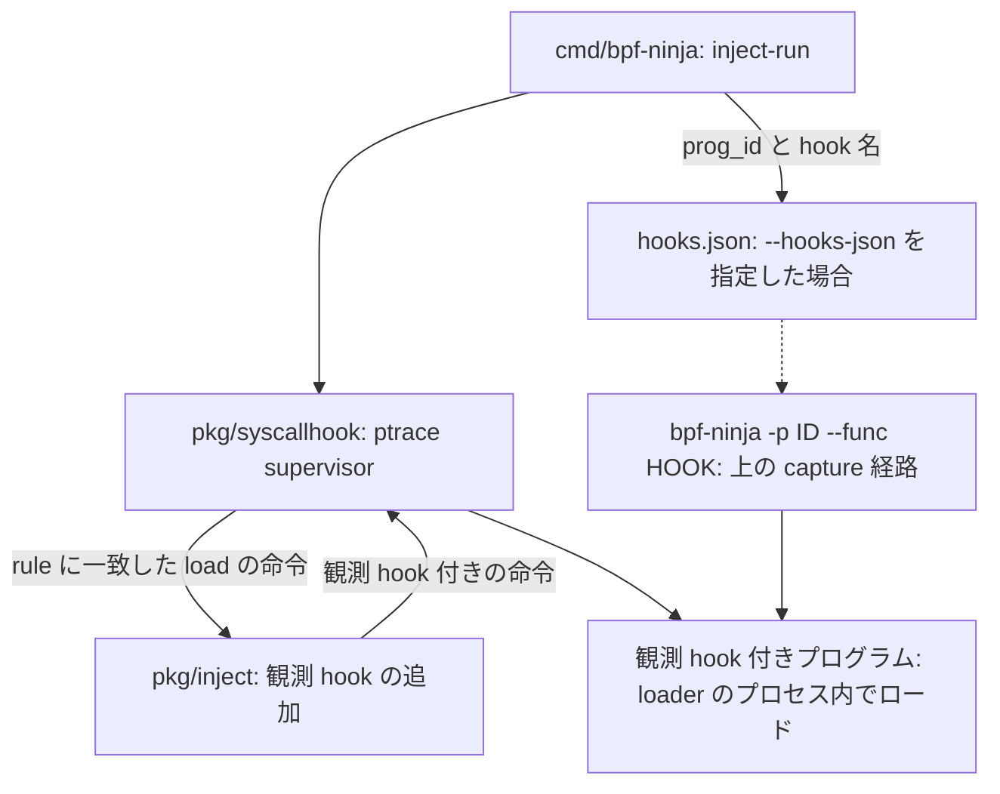

# 実装を読むための案内

このページでは、現在の実装を処理の流れに沿って説明します。調べる対象ごとの実装と関連文書も示します。

## 全体の構造

capture では、`cmd/bpf-ninja` が target を探します。続いて `internal/program` がフィルターをコンパイルし、プログラムを attach します。
矢印は呼び出しや生成を、ラベル付きの矢印はデータの流れを表します。

`internal/program` は、hook 種別の能力に合わせて `pkg/kunai` でフィルターをコンパイルします。生成した tracing プログラムは、target プログラムの関数に fentry または fexit で attach します。
`--mode xdp` では、bpf-ninja のプログラムを XDP として netdev に attach します。
`internal/capture` は、プログラムが ringbuf に書いた記録を読み取ります。`internal/output` は、`-w` を付けた場合はファイルに、付けない場合は標準出力に pcapng を書き出します。

inject-run では、loader 自身がロードするプログラムに観測 hook を加えます。その hook に対して、上の capture を attach します。
矢印は呼び出しや生成を、ラベル付きの矢印はデータの流れを、点線は利用者の操作を表します。

`pkg/syscallhook` は loader の `BPF_PROG_LOAD` を横取りします。rule に一致したプログラムには `pkg/inject` で観測 hook を追加し、loader のプロセス内でロードします。
一致しないプログラムはそのままロードされ、注入に失敗した場合も `--fail-closed` がなければ元のプログラムをロードします。
`--hooks-json` を指定すると、`cmd/bpf-ninja` が `prog_id` と hook 名を `hooks.json` に書くので、それを `-p` と `--func` に渡します。

## CLI から出力まで

| 調べる対象 | 実装 | 説明と契約 |
|---|---|---|
| 引数と target の探索 | [cmd/bpf-ninja](../../../cmd/bpf-ninja/)、[internal/attach](../../../internal/attach/) | [利用ガイド](../dsl-usage.md)、[対応 hook](../../../README.md#modes) |
| 関数ごとの map 利用と注入可否の表示 | [listmaps.go](../../../cmd/bpf-ninja/listmaps.go)、[mapuse.go](../../../internal/attach/mapuse.go) | [map 利用から観測までの手順](../../en/inject-walkthrough.md) |
| load 前の観測 hook 注入 | [pkg/inject](../../../pkg/inject/) | [map 操作の観測](../../en/lookup-site-injection.md)、[監査済み u32 値の観測](../../en/typed-injection.md) |
| 未変更 loader の起動と load 時注入 | [inject-run CLI](../../../cmd/bpf-ninja/inject_run.go)、[pkg/syscallhook](../../../pkg/syscallhook/) | [syscall hook 設計](../../en/bpf-syscall-hook-design.md)、[inject-run の制約と操作](../../en/inject-run.md) |
| hook 種別ごとの能力と packet layout | [internal/hook](../../../internal/hook/)、[host adapters](../../../pkg/kunai/host/) | [DSL internals](../dsl-internals.md) |
| 構文から型付き IR への変換 | [parser](../../../pkg/kunai/parser/)、[resolve](../../../pkg/kunai/resolve/)、[ir](../../../pkg/kunai/ir/) | [文法](../dsl-grammar.md)、[型の仕様](../dsl-types.md) |
| protocol の定義とロード | [protocols](../../../pkg/kunai/protocols/)、[vocab](../../../pkg/kunai/vocab/) | [vocab 作成](../dsl-vocab-authoring.md) |
| eBPF 命令と host ABI | [codegen](../../../pkg/kunai/codegen/)、[internal/program](../../../internal/program/) | [codegen 解説](../kunai-codegen-deepdive.md)、[option accumulator](../dsl-multi-option-accumulator.md) |
| ringbuf と reader | [internal/capture](../../../internal/capture/) | [capture datapath](../capture-datapath.md) |
| writer、合算、完了 | [internal/output](../../../internal/output/)、[CLI lifecycle](../../../cmd/bpf-ninja/) | [capture lifecycle](../../capture-lifecycle.md) |
| 回帰試験と形式モデル | [dsltest](../../../pkg/kunai/dsltest/)、[Lean](../../../spec/lean/) | [privileged tests](../../privileged-tests.md)、[Lean README](../../../spec/lean/README.md) |

## 解説記事と仕様の使い分け

[kunai 概説](../kunai-overview-article.md)、[DSL deep-dive](../kunai-dsl-deepdive.md)、[codegen deep-dive](../kunai-codegen-deepdive.md)は、実装の考え方を読むための連載です。
サポートする式は文法と型の仕様、実際の対応は同じ版の実装と回帰試験で確認してください。
ABI の定数、ライブラリ API、build 手順は変更するコードの近くに正本を残します。
横断的な説明のために、それらを別の場所へ複製しません。

## 設計判断を追う

[ADR 台帳](../adr/README.md)は採用、却下、置換を記録します。
番号と場所を維持し、置換時は過去の結論を書き換えず、置換先への参照を追加します。

| 記録 | 状態 | 読むときの条件 |
|---|---|---|
| [0001 zero-copy flush](../adr/0001-fast-reader-zero-copy-flush.md) | 却下 | 当時の reader ownership と測定条件に対する判断 |
| [0002 split-core 幅](../adr/0002-split-core-capture-optimal-width.md) | 採用 | 64 論理 CPU、E810、128B、cpumap 負荷の記録。全環境の最適値ではない |
| [0003 callback cursor mask](../adr/0003-mask-bpf-loop-cursor.md) | 採用 | 記載された kernel と verifier の問題に対する判断 |

[Lean Decisions](../../../spec/lean/DECISIONS.md)の `D-NNN` は、意味論の未確定点と Go/Lean の差を追う別の台帳です。
Lean の記録にある提案中や承認済みという状態は、その台帳での意味を保ちます。
ADR の状態への変換や番号の統合は行いません。
Lean は DSL と parser-machine のモデルであり、eBPF 命令意味論、codegen correctness、verifier 全体の証明を含みません。

## 保守

- CLI の挙動を変えたら、利用手順と該当する回帰試験を更新する。
- ABI や output 契約を変えたら、近接する定義と横断解説の該当箇所を確認する。
- 設計の理由を変えたら、既存 ADR との関係を記録する。
- 測定を根拠にする場合は [研究資料の記録項目](../research/README.md)を満たす。

[DSL 索引](../dsl-overview.md) · [Repository README](../../../README.md)
